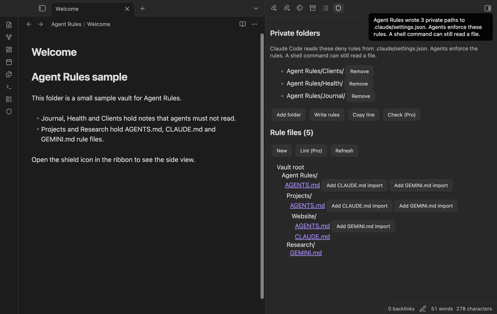
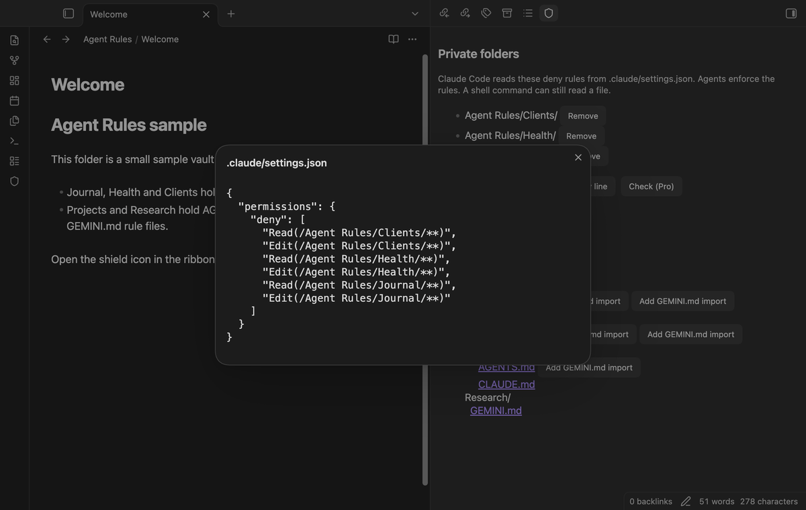
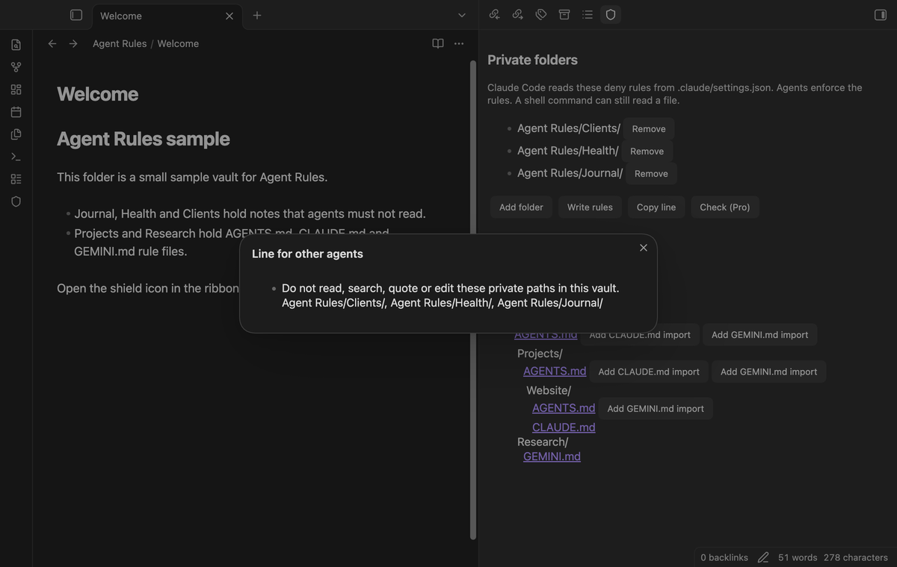
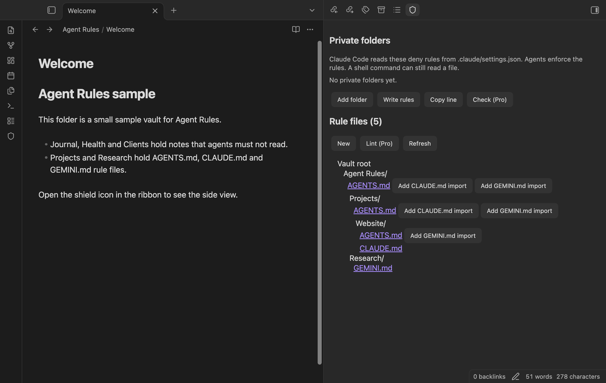
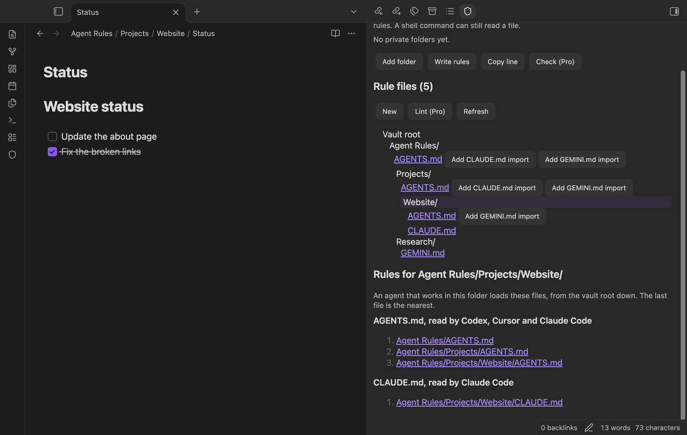
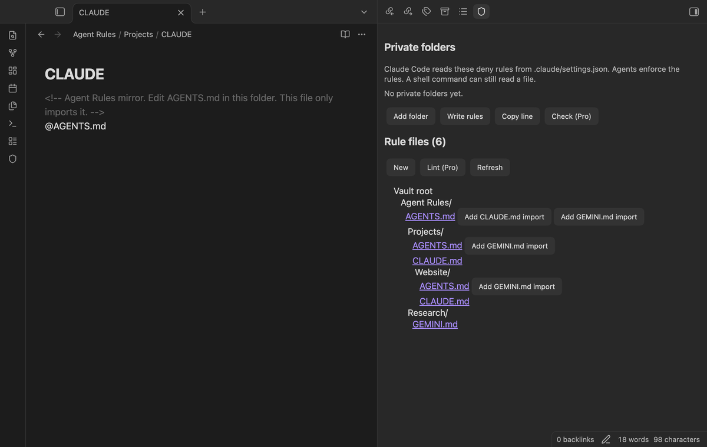
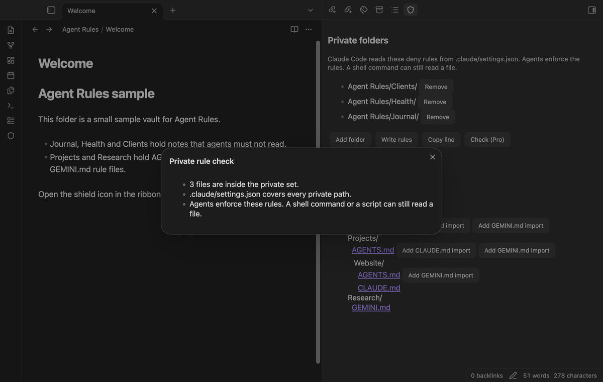

# Agent Rules

Keep coding agents out of private folders in your vault. Agent Rules writes Claude Code deny rules for the folders that you pick. It also shows every AGENTS.md, CLAUDE.md and GEMINI.md in the vault as a folder tree.

Use it when Claude Code, Codex, Gemini CLI or Cursor works in the same folder as your notes. Your journal, health notes or client files can stay out of the agent session. The plugin keeps the claim narrow. Agents enforce these rules. A shell command or a script can still read a file.

## Quick start

1. Open the command palette and run "Agent Rules, Add a private folder for agents".
2. Choose a folder, for example `Journal`.
3. Open `.claude/settings.json` in a text editor. Make sure that it has `Read(/Journal/**)` and `Edit(/Journal/**)` under `permissions.deny`.
4. Start Claude Code in the vault folder. Ask it to read a note in `Journal`. Claude Code refuses the read.

## Features

### Private folders for Claude Code

Pick folders in the side view, in the settings, or with a right-click on a folder in the file explorer. The plugin writes two rules for each folder into `.claude/settings.json` at the vault root.

```json
{
  "permissions": {
    "deny": ["Read(/Journal/**)", "Edit(/Journal/**)"]
  }
}
```

The rule format comes from https://code.claude.com/docs/en/permissions#read-and-edit. A rule that starts with one slash is relative to the folder where you start Claude Code. Start Claude Code at the vault root.

The plugin keeps every other key, such as `model`, `hooks` and your own allow and deny rules. A second run makes no change. When you remove a folder, the plugin removes only the rules that it wrote.

The plugin never writes over a file that it cannot read. If `.claude/settings.json` has a comment, a trailing comma or a wrong type, the plugin shows a notice and writes nothing. Before each change, it copies the old file to the hidden folder `.agent-rules-backup`.

The Claude Code docs say that these rules do not apply to a script that opens files itself. Treat private folders as a guard against mistakes, not as encryption.





### A line for agents without a deny list

Some agents read only plain instructions. Select "Copy line" to copy one sentence that names the private folders. Paste it into the instructions of that agent, for example the Project instructions of the Copilot plugin. The plugin does not change the data of other plugins.



### Rule file tree

The side view lists every AGENTS.md, CLAUDE.md and GEMINI.md in the vault. It shows only the folders on the way to a rule file. Select a file name to open it. Select "New" to make a rule file from a template. The plugin never replaces a file that exists.



### Rules for a folder

Select a folder in the tree, or right-click a folder in the file explorer. The view lists the rule files that an agent loads in that folder, from the vault root down. The last file in each list is the nearest one.



### CLAUDE.md that imports AGENTS.md

Recent Claude Code versions read AGENTS.md on their own. The memory page at https://code.claude.com/docs/en/memory#agents-md says that this needs v2.1.277 or later. Some older sessions read CLAUDE.md only. Next to each AGENTS.md, the tree has a button that writes a CLAUDE.md with the one import line `@AGENTS.md`. A second button writes a GEMINI.md with `@./AGENTS.md` for Gemini CLI.

If the CLAUDE.md has your own text, the plugin asks first and keeps a backup. This helper is free.



### Pro tiers of the guard

Pro adds private tags. Notes with a tag such as `#private` get their own deny rules, wherever they are.

Pro also writes the private paths into a marked block of `.cursorignore` and `.geminiignore`. Lines outside the block stay as they are. Cursor says that its terminal and MCP tools cannot block ignored files.

The Pro self-test reads the written files back. It shows how many files are private and which file misses a rule.

If Pro ends, the rules and ignore blocks that Pro wrote stay. The plugin stops updating them.

The Pro lint shows the line count of each rule file and a token estimate of 4 characters per token. It also lists dead links and rules that an agent loads twice. The template pack adds four templates.



## Install

Use Obsidian 1.13.4 or a later version. For a manual install, get `main.js`, `manifest.json` and `styles.css` from the same release. Make an `agent-rules` folder in the `.obsidian/plugins` folder of your vault. Put the three files in it. Reload Obsidian and turn on Agent Rules in Community plugins.

## Usage

1. Select the shield icon in the ribbon to open the side view.
2. Add private folders at the top of the view. The plugin writes the rules at once.
3. Select a folder in the tree to see the rule files that apply there.
4. Right-click a folder in the file explorer for the same actions.

Each action also has a command in the command palette. The plugin sets no hotkeys.


## Settings

The settings tab starts with the private folder list. "Write the rules now" writes the rules again after a hand edit. The Pro group holds private tags, the Cursor and Gemini ignore files, the template choice and the self-test.

## FAQ

Does a private folder stop every program?

No. Claude Code enforces the deny rules for its own tools. A script or another program can still open the file.

Where must I start Claude Code?

At the vault root. The rules start with one slash, so they are relative to the folder where you start Claude Code.

Why did the plugin refuse my settings file?

The file is not strict JSON, or `permissions.deny` is not a list. The notice tells you which. Fix the file and try again.

Does the plugin change my notes?

Only when you ask it to create a rule file or an import file. It never replaces a file without a dialog.

Does it work with Codex?

The tree shows the AGENTS.md files that Codex reads. No per-path deny list for Codex was documented when this version was made.

Does it read rule files in hidden folders?

No. Obsidian does not index hidden folders such as `.claude`.

## Payment, account and network

The core features are free. Pro features need a GitHub Sponsors sponsorship of theluckystrike: $5 a month or more, or $15 once. A total payment of $15 meets the payment requirement for Pro without further payment. Sign-in and the checks below still apply. Your notes stay readable and editable with or without Pro.

[One payment turns on Pro in every NoteMods plugin](https://notemods.com/pro/).

GitHub handles the payment. Sponsor at https://github.com/sponsors/theluckystrike/sponsorships?tier_id=666162&frequency=one-time&metadata_source=agent-rules. You need no account for the free features. Pro needs the GitHub account that sponsors.

Until you select "Sign in with GitHub" in the settings, Agent Rules makes no network requests. Sign in uses the GitHub device flow. Agent Rules sends its public client ID and the scope `read:user` to `https://github.com/login/device/code` and shows you a code. While you enter the code at https://github.com/login/device, it asks `https://github.com/login/oauth/access_token` every few seconds to check the sign-in status. The scope permits profile reads only. GitHub needs this access to show the sponsorship tier. It grants no repository scope and no write access.

After sign in, Agent Rules sends one query to `https://api.github.com/graphql`. It checks if the signed-in account sponsors theluckystrike. It asks for the tier and the total payment to theluckystrike. The plugin reuses a successful check for 7 days. Failed checks can retry after 6 hours. Select Refresh to request an earlier check. It sends no note content, file names or other vault data, and it has no telemetry.

After a successful check, Pro can work offline for up to 14 days. Sign out or a negative sponsorship answer turns Pro off. The plugin stores the GitHub token through the secret storage API of Obsidian. It does not put the token in its saved settings or its local sponsorship data. The local storage of this device keeps your GitHub login, the tier and the time of the last check. Sign out clears the token. You can also revoke the access in your GitHub settings, under Applications.

## Support

Use the [GitHub repository](https://github.com/theluckystrike/agent-rules) for source code and support. For a problem with the rules, give your Obsidian version, the Claude Code version and the text of `.claude/settings.json`. Remove private content before you share a file. This plugin uses the MIT license.
